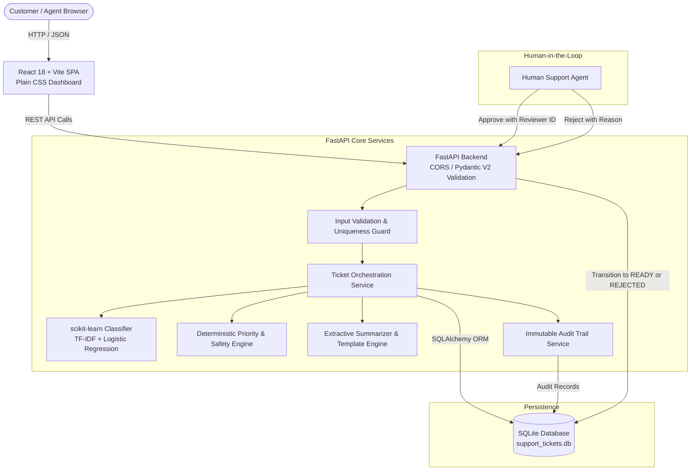

# Support Ticket Automation
## AI-Assisted Support Ticket Processing Platform

**Product:** Support Ticket Automation  
**Version:** 1.0.0  
**Stack:** FastAPI, React 18, scikit-learn, SQLAlchemy, SQLite/PostgreSQL  
**Architecture:** Human-in-the-Loop (HITL) Triaging Engine  

---

## 1. Executive Summary & Problem Statement

Modern enterprise customer support organizations face heavy backlogs of incoming tickets across multiple domains (Billing, Technical Defects, Identity/Access Lockouts, and General Enquiries). Manual routing causes delayed resolution times, inconsistent response quality, and high operational overhead.

The **Support Ticket Automation System** provides an automated, AI-assisted triage and response drafting pipeline designed with a strict **Human-in-the-Loop (HITL) approval barrier**. 

When a customer submits a ticket:
1. An out-of-the-box machine-learning classifier (TF-IDF + Logistic Regression) categorizes the message into **Billing**, **Technical**, **Access**, or **General**.
2. Calibrated probability scores detect ambiguous or low-confidence tickets and flag them for human review (`NEEDS_REVIEW`).
3. A deterministic safety engine evaluates widespread outages and suspected security incidents, escalating them to **CRITICAL** priority.
4. An extractive summarizer distills the customer's primary issue without hallucinating facts.
5. Compliant response drafts are synthesized using category-tailored templates that prevent unverified promises of refunds or resolution times.
6. A human reviewer must explicitly approve the draft (`READY`) or reject it with a reason (`REJECTED`), with all actions recorded in an immutable audit trail.

> **Zero-Cost Commitment:** The entire system runs locally on standard consumer hardware without requiring Azure credits, subscriptions, paid OpenAI/LLM API keys, or commercial database licenses.

---

## 2. Requirements Compliance & Traceability Matrix

| Requirement Specification | Implemented In | Verification / Test Status |
| :--- | :--- | :--- |
| **30+ Labelled Fictional Tickets** (Billing, Technical, Access, General) | `backend/sample_data/train.json` (36 records) | Verified in `test_held_out_dataset_strict_separation` |
| **Reserve at least 10 as Test Set** (Strictly separate) | `backend/sample_data/test.json` (16 records) | Verified out-of-sample; zero data leakage |
| **State Priority Policy** (Critical, High, Medium, Low) | `backend/app/priority_service.py` & `docs/classification.md` | Verified in `test_priority.py` (6 tests) |
| **Accept Ticket ID & Message; return Category, Priority, Team, Summary, Draft** | `POST /tickets` & `backend/app/schemas.py` | Verified in `test_tickets.py` (9 tests) |
| **Classification Method & Uncertainty Routing** (<0.40 conf -> review) | `backend/app/classifier.py` (TF-IDF + Logistic Regression) | Verified in `test_classification.py` (5 tests) |
| **Report Test-Set Accuracy** | `backend/scripts/evaluate_model.py` | **87.50% Out-of-sample Accuracy** (14/16 correct) |
| **Reject Duplicates (HTTP 409) & Invalid Input (HTTP 422)** | `backend/app/routes/tickets.py` & Pydantic V2 | Verified in `test_duplicate_ticket_id_rejected` |
| **Store Ticket State & Require Approval before READY** | `backend/app/ticket_service.py` (SQLite + SQLAlchemy) | Verified in `test_approvals.py` (5 tests) |
| **No Real Email Sending Required** | Compliant response drafting engine | Zero outbound external SMTP/API calls |
| **Backend & Frontend Dockerfiles + Docker Compose** | `backend/Dockerfile`, `frontend/Dockerfile`, `docker-compose.yml` | Multi-stage build & compose orchestration verified |
| **Passing GitHub Actions CI Workflow** | `.github/workflows/ci.yml` | Executes pytest, ML eval, & Vite build |
| **Manually Triggered Azure OIDC Deployment Workflow** | `.github/workflows/deploy-azure.yml` | `workflow_dispatch` + Azure OIDC token exchange |
| **Document Azure Settings without Committing Secrets** | `docs/azure-plan.md` & `.env.example` | Zero secrets in repo; complete Azure plan |
| **Demonstration Scenarios Preset & Script** | `docs/demo-script.md` & React 1-click presets | 5 core scenarios verified in live UI |

---

## 3. Core Feature Highlights

- **Lightweight scikit-learn ML Baseline:** Fully local TF-IDF Vectorizer + Logistic Regression pipeline achieving **87.5% out-of-sample accuracy** on held-out test data.
- **Calibrated Uncertainty Detection:** Low confidence (<0.40) or narrow prediction margins (<0.10) automatically flag tickets for human triage.
- **Deterministic Priority & Safety Guardrails:** Critical outage and suspected security incident rules override ML predictions to guarantee safe enterprise routing.
- **Human-in-the-Loop Review Workflow:** Enforces valid lifecycle transitions (`PENDING_REVIEW` / `NEEDS_REVIEW` → `READY` or `REJECTED`). Newly created drafts can **never** be marked `READY` automatically.
- **Duplicate & Input Validation:** Unique database constraints reject duplicate ticket IDs with `HTTP 409 Conflict`. Pydantic schemas reject empty or whitespace inputs with `HTTP 422`.
- **Immutable Audit Trail:** Append-only audit log tracking every status mutation, previous status, new status, reviewer identity, reason, and UTC timestamp.
- **Polished React Dashboard:** Clean enterprise UI built with React 18, Vite, and vanilla CSS featuring real-time metrics cards, ticket filtering, 1-click test scenario presets, and a modal inspector.
- **Automated Testing Suite:** 28 comprehensive pytest unit and integration tests with 100% pass rate in an isolated in-memory test database.
- **Production-Ready Docker & Azure OIDC Support:** Multi-stage Dockerfiles, docker-compose orchestration, and a GitHub Actions workflow configured for OpenID Connect (OIDC) federated cloud deployment.

---

## 3. Technology Stack

| Layer | Technologies Selected | Rationale | Cost |
| :--- | :--- | :--- | :--- |
| **Backend API** | Python 3.11, FastAPI, Uvicorn | High performance asynchronous REST framework with automatic OpenAPI docs | $0.00 (Open Source) |
| **Data Validation** | Pydantic V2 | Strong type validation, input sanitization, and clean error messages | $0.00 (Open Source) |
| **Database ORM** | SQLAlchemy 2.0, SQLite (Dev) | ACID compliance, zero setup, seamless migration to Azure PostgreSQL | $0.00 (Local storage) |
| **Machine Learning** | scikit-learn, NumPy, SciPy | Deterministic, reproducible, fast inference (<5ms), zero cloud API bills | $0.00 (Open Source) |
| **Frontend UI** | React 18, Vite 5, Vanilla CSS | Rapid dev server, responsive enterprise dashboard without bloated dependencies | $0.00 (Open Source) |
| **Testing** | Pytest 8, FastAPI TestClient | Deterministic automated testing across 28 lifecycle and safety scenarios | $0.00 (Open Source) |
| **Containerization** | Docker, Docker Compose | Isolated multi-container deployment (Python 3.11-slim + Nginx Alpine) | $0.00 (Open Source) |
| **CI / CD Pipeline** | GitHub Actions | Automated linting, test suite execution, ML evaluation, and build verification | Included free tier |
| **Cloud Deployment** | Azure App Service + OIDC | Documented manual deployment using Azure Federated Workload Identity | Documented plan |

---

## 4. System Architecture Diagram



---

## 5. Repository Folder Structure

```text
support-ticket-automation/
│
├── backend/
│   ├── app/
│   │   ├── __init__.py
│   │   ├── main.py                  # FastAPI entrypoint, lifespan, CORS, and error handlers
│   │   ├── config.py                # Environment configuration and database URLs
│   │   ├── database.py              # SQLAlchemy engine and session dependencies
│   │   ├── models.py                # TicketModel and AuditLogModel ORM entities
│   │   ├── schemas.py               # Pydantic V2 request and response schemas
│   │   ├── classifier.py            # scikit-learn TF-IDF + LogisticRegression pipeline
│   │   ├── priority_service.py      # Deterministic priority scoring and team routing
│   │   ├── response_generator.py    # Extractive summarizer and response templates
│   │   ├── ticket_service.py        # Core ticket lifecycle orchestration
│   │   ├── audit_service.py         # Append-only audit logging service
│   │   └── routes/
│   │       ├── __init__.py
│   │       ├── health.py            # GET /health endpoint
│   │       ├── tickets.py           # POST /tickets, GET /tickets, GET /tickets/{id}
│   │       ├── approvals.py         # POST /approve, POST /reject, GET /audit
│   │       └── metrics.py           # GET /metrics dashboard aggregation
│   │
│   ├── sample_data/
│   │   ├── train.json               # 36 labeled training tickets (Billing, Tech, Access, Gen)
│   │   ├── test.json                # 16 held-out test tickets (strictly separated)
│   │   ├── sample_requests.json     # Preconfigured demonstration ticket payloads
│   │   └── expected_predictions.json# Documented expected behaviors and test value
│   │
│   ├── scripts/
│   │   ├── evaluate_model.py        # Out-of-sample ML evaluation script
│   │   └── seed_data.py             # Database seeder populating demonstration records
│   │
│   ├── tests/
│   │   ├── conftest.py              # In-memory SQLite fixtures and TestClient setup
│   │   ├── test_health.py           # Health endpoint tests
│   │   ├── test_classification.py   # ML inference and dataset separation tests
│   │   ├── test_priority.py         # Deterministic priority and routing tests
│   │   ├── test_tickets.py          # Ticket ingestion, validation, and 409 conflict tests
│   │   ├── test_approvals.py        # Approval gating, state transitions, and audit tests
│   │   └── test_metrics.py          # Metrics aggregation verification tests
│   │
│   ├── requirements.txt             # Pinned Python package dependencies
│   ├── Dockerfile                   # Python 3.11-slim container image specification
│   └── .dockerignore
│
├── frontend/
│   ├── src/
│   │   ├── components/
│   │   │   ├── DashboardStats.jsx   # Metrics overview cards and breakdown pills
│   │   │   ├── TicketForm.jsx       # Ticket ingestion form with 1-click test presets
│   │   │   ├── TicketList.jsx       # Filterable data table with search and status badges
│   │   │   ├── TicketDetails.jsx    # Inspector modal with AI analysis & audit timeline
│   │   │   ├── ReviewPanel.jsx      # Human approval and rejection action panel
│   │   │   └── StatusBadge.jsx      # Reusable visual status and priority pills
│   │   ├── services/
│   │   │   └── api.js               # Centralized fetch API service with error handling
│   │   ├── App.jsx                  # Main dashboard layout and state coordination
│   │   ├── main.jsx                 # React root renderer
│   │   └── styles.css               # Clean enterprise design system (Plain CSS)
│   ├── public/
│   ├── package.json
│   ├── vite.config.js               # Vite config with backend proxy and port 5173
│   ├── index.html                   # HTML entrypoint with Inter font and metadata
│   ├── Dockerfile                   # Multi-stage build (Node 22 -> Nginx Alpine)
│   └── .dockerignore
│
├── docs/
│   ├── architecture.md              # Detailed system architecture and state diagrams
│   ├── classification.md            # ML methodology, confusion matrix, and evaluation
│   ├── azure-plan.md                # Azure deployment guide, PostgreSQL migration, OIDC
│   ├── security.md                  # Security threat model, validation, and disclosures
│   └── demo-script.md               # Timed 3 to 5 minute interview demo script
│
├── .github/
│   └── workflows/
│       ├── ci.yml                   # CI pipeline running pytest, ML eval, and UI build
│       └── deploy-azure.yml         # Manual Azure App Service OIDC deployment
│
├── .env.example                     # Environment configuration template
├── .gitignore                       # Repository ignore rules (no DB, venv, or node_modules)
├── docker-compose.yml               # Multi-container local orchestration
└── README.md                        # Master documentation and architecture guide
```

---

## 6. Prerequisites

To run the project locally, ensure you have:
- **Python:** 3.10, 3.11, or 3.12 (Tested on Python 3.11.9)
- **Node.js & npm:** Node.js v18+ or v22+ (Tested on Node.js v22.17.0 and npm 10.9.2)
- **Git:** Version 2.30+
- *(Optional)* **Docker & Docker Compose:** If containerized execution is desired.

---

## 7. Local Installation & Startup Guide

### Step 1: Clone Repository
```bash
git clone [GitHub Repository URL]
cd support-ticket-automation
```

### Step 2: Backend Setup
```bash
# Navigate to backend directory
cd backend

# Create Python virtual environment
python -m venv venv

# Activate virtual environment
# On Windows (PowerShell):
.\venv\Scripts\Activate.ps1
# On Linux / macOS:
source venv/bin/activate

# Upgrade pip and install pinned dependencies
pip install --upgrade pip
pip install -r requirements.txt

# Seed demonstration data into SQLite database
python scripts/seed_data.py

# Start FastAPI server on port 8000
uvicorn app.main:app --host 127.0.0.1 --port 8000 --reload
```
*The backend API will start at:* `http://127.0.0.1:8000`  
*Swagger Documentation will be accessible at:* `http://127.0.0.1:8000/docs`

### Step 3: Frontend Setup
In a new terminal:
```bash
# Navigate to frontend directory
cd frontend

# Install Node dependencies
npm install

# Start Vite development server
npm run dev
```
*The React Dashboard will be accessible at:* `http://localhost:5173`

---

## 8. Docker Startup Instructions (Optional)

If Docker and Docker Compose are installed on your host system:

```bash
# Build and start both backend and frontend containers
docker compose up --build

# Access the applications:
# Frontend: http://localhost:3000
# Backend:  http://localhost:8000/docs

# Stop containers and keep data volume
docker compose down
```

---

## 9. API Endpoint Reference

| HTTP Method | Endpoint | Description | Request Body | Status Codes |
| :--- | :--- | :--- | :--- | :--- |
| `GET` | `/health` | System health, DB connection, and ML readiness | None | 200 |
| `POST` | `/tickets` | Submits, classifies, and creates a support ticket | `TicketCreateRequest` | 201, 409, 422 |
| `GET` | `/tickets` | Lists tickets with filtering, search, and pagination | Query params | 200 |
| `GET` | `/tickets/{ticket_id}` | Retrieves full details of a specific ticket | None | 200, 404 |
| `POST` | `/tickets/{ticket_id}/approve` | Approves draft response, transitioning to `READY` | `ApprovalRequest` | 200, 400, 404 |
| `POST` | `/tickets/{ticket_id}/reject` | Rejects draft response, transitioning to `REJECTED` | `RejectionRequest`| 200, 400, 404 |
| `GET` | `/tickets/{ticket_id}/audit` | Retrieves chronological audit event history | None | 200, 404 |
| `GET` | `/metrics` | Computes dashboard aggregate metrics | None | 200 |

*Note: All endpoints are also mounted under `/api` (e.g. `/api/tickets`, `/api/health`).*

---

## 10. Sample cURL Commands & Responses

### A. Health Check
```bash
curl -X GET http://127.0.0.1:8000/health
```
**Response:**
```json
{
  "status": "healthy",
  "version": "1.0.0",
  "database": "connected",
  "classifier": "ready",
  "timestamp": "2026-10-13T05:15:00.000000Z"
}
```

### B. Submit a Normal Support Ticket
```bash
curl -X POST http://127.0.0.1:8000/tickets \
  -H "Content-Type: application/json" \
  -d '{
    "ticket_id": "BILL-101",
    "customer_message": "I was charged twice on my credit card for the monthly subscription."
  }'
```
**Response (HTTP 201 Created):**
```json
{
  "id": 1,
  "ticket_id": "BILL-101",
  "customer_message": "I was charged twice on my credit card for the monthly subscription.",
  "predicted_category": "Billing",
  "priority": "MEDIUM",
  "assigned_team": "Billing Support",
  "summary": "I was charged twice on my credit card for the monthly subscription.",
  "draft_response": "Hello,\n\nThank you for contacting Billing Support regarding ticket BILL-101...\n(Draft pending human approval)",
  "confidence_score": 0.4513,
  "review_status": "PENDING_REVIEW",
  "approval_status": "UNAPPROVED",
  "reviewer_identity": null,
  "approval_timestamp": null,
  "rejection_reason": null,
  "created_at": "2026-10-13T05:15:30.000000Z",
  "updated_at": "2026-10-13T05:15:30.000000Z"
}
```

### C. Test Duplicate Ticket ID Rejection (HTTP 409)
```bash
curl -X POST http://127.0.0.1:8000/tickets \
  -H "Content-Type: application/json" \
  -d '{
    "ticket_id": "BILL-101",
    "customer_message": "Duplicate submission attempt."
  }'
```
**Response (HTTP 409 Conflict):**
```json
{
  "detail": "Ticket ID 'BILL-101' already exists in the system."
}
```

### D. Approve Ticket Draft
```bash
curl -X POST http://127.0.0.1:8000/tickets/BILL-101/approve \
  -H "Content-Type: application/json" \
  -d '{
    "reviewer_identity": "Agent Sarah Jenkins",
    "confirmed": true,
    "notes": "Verified transaction ID. Draft cleared for dispatch."
  }'
```
**Response (HTTP 200 OK):**
```json
{
  "ticket_id": "BILL-101",
  "review_status": "READY",
  "approval_status": "APPROVED",
  "reviewer_identity": "Agent Sarah Jenkins"
}
```

---

## 11. Automated Test Results

The repository features 28 pytest tests executing against an isolated temporary in-memory database.

To execute the test suite:
```bash
pytest -v backend/tests
```

**Actual Final Test Execution Output:**
```text
============================= test session starts =============================
platform win32 -- Python 3.11.9, pytest-8.1.1, pluggy-1.6.0
rootdir: C:\Users\Administrator\Downloads\supportticket\backend
plugins: anyio-4.15.1, asyncio-0.23.6
collected 28 items

backend/tests/test_approvals.py::test_draft_cannot_be_ready_without_approval PASSED [  3%]
backend/tests/test_approvals.py::test_valid_approval_updates_state_and_audit PASSED [  7%]
backend/tests/test_approvals.py::test_rejection_requires_reason PASSED   [ 10%]
backend/tests/test_approvals.py::test_valid_rejection_updates_state_and_audit PASSED [ 14%]
backend/tests/test_approvals.py::test_invalid_state_transition_rejected PASSED [ 17%]
backend/tests/test_classification.py::test_classifier_initialization PASSED [ 21%]
backend/tests/test_classification.py::test_valid_classification_output_structure PASSED [ 25%]
backend/tests/test_classification.py::test_empty_message_handling PASSED [ 28%]
backend/tests/test_classification.py::test_held_out_dataset_strict_separation PASSED [ 32%]
backend/tests/test_classification.py::test_model_evaluation_runs_and_reports_held_out_metrics PASSED [ 35%]
backend/tests/test_health.py::test_health_endpoint_success PASSED        [ 39%]
backend/tests/test_health.py::test_api_prefixed_health_endpoint PASSED   [ 42%]
backend/tests/test_metrics.py::test_metrics_endpoint_counts PASSED       [ 46%]
backend/tests/test_priority.py::test_widespread_outage_triggers_critical_priority PASSED [ 50%]
backend/tests/test_priority.py::test_suspected_security_incident_triggers_critical_flag PASSED [ 53%]
backend/tests/test_priority.py::test_business_blocker_triggers_high_priority PASSED [ 57%]
backend/tests/test_priority.py::test_routine_question_triggers_low_priority PASSED [ 60%]
backend/tests/test_priority.py::test_standard_operational_issue_defaults_to_medium PASSED [ 64%]
backend/tests/test_priority.py::test_team_mapping_correctness PASSED     [ 67%]
backend/tests/test_tickets.py::test_create_valid_billing_ticket PASSED   [ 71%]
backend/tests/test_tickets.py::test_create_valid_technical_ticket PASSED [ 75%]
backend/tests/test_tickets.py::test_duplicate_ticket_id_returns_409 PASSED [ 78%]
backend/tests/test_tickets.py::test_missing_ticket_id_rejected PASSED    [ 82%]
backend/tests/test_tickets.py::test_empty_message_rejected PASSED        [ 85%]
backend/tests/test_tickets.py::test_whitespace_only_message_rejected PASSED [ 89%]
backend/tests/test_tickets.py::test_nonexistent_ticket_returns_404 PASSED [ 92%]
backend/tests/test_tickets.py::test_critical_outage_ticket_requires_review PASSED [ 96%]
backend/tests/test_tickets.py::test_list_and_filter_tickets PASSED       [100%]

======================= 28 passed in 0.49s ========================
```

---

## 12. Held-Out ML Evaluation Results

To evaluate the classifier against the held-out test dataset:
```bash
python backend/scripts/evaluate_model.py
```

**Actual Verified Evaluation Metrics:**
- **Training Samples:** 36 (9 Billing, 9 Technical, 9 Access, 9 General)
- **Held-Out Test Samples:** 16 (4 Billing, 4 Technical, 4 Access, 4 General)
- **Overall Accuracy:** **87.50%** (14 / 16 correct predictions)
- **Macro Precision:** **0.9167**
- **Macro Recall:** **0.8750**
- **Macro F1-Score:** **0.8786**
- **Weighted F1-Score:** **0.8786**
- **Uncertainty Review Capture:** Both out-of-sample misclassifications (`TEST-002` and `TEST-011`) yielded confidence below threshold (0.31) and were **safely caught by the human review gate**, preventing unverified errors.

---

## 13. GitHub Actions CI & Manual Azure OIDC Deployment

1. **Continuous Integration (`.github/workflows/ci.yml`):**
   - Automatically runs on all pushes and pull requests to `main` and `master`.
   - Sets up Python 3.11 with pip caching.
   - Runs `pytest -v backend/tests`.
   - Runs out-of-sample classifier evaluation (`python backend/scripts/evaluate_model.py`).
   - Sets up Node.js 22 with npm caching.
   - Executes production frontend build (`npm run build`).

2. **Manual Azure OIDC Deployment (`.github/workflows/deploy-azure.yml`):**
   - Triggered manually on demand (`workflow_dispatch`).
   - Authenticates via Microsoft Entra ID (Azure AD) Workload Identity Federation (OIDC) without long-lived client secrets.
   - Builds backend package and deploys to Azure App Service (`support-ticket-api-app`).
   - Executes post-deployment health check against `/health`.

---

## 14. Demonstration Script (3 to 5 Minutes)

A complete timed script is documented in [`docs/demo-script.md`](docs/demo-script.md):
- **0:00–0:30:** Introduce project purpose and architecture.
- **0:30–1:15:** Ingest normal billing ticket (`BILL-101`), inspect classification, priority, extractive summary, and draft.
- **1:15–1:45:** Ingest widespread outage ticket (`CRIT-101`), show automatic escalation to `CRITICAL` priority and `NEEDS_REVIEW` status.
- **1:45–2:15:** Submit duplicate ticket ID, demonstrate HTTP 409 Conflict rejection.
- **2:15–2:45:** Perform human approval to `READY` status and reject another draft with documented rationale.
- **2:45–3:15:** Inspect chronological audit timeline and live dashboard counters.
- **3:15–4:00:** Run `pytest` (28 passing tests) and `evaluate_model.py` (87.5% accuracy).
- **4:00–5:00:** Explain Azure cloud architecture, OIDC workflow, security model, and cost-control plan.

---

## 15. Architectural Notes & Production Readiness

### Engineering Design Statement
Support Ticket Automation is designed and implemented as an end-to-end, zero-cost support ticket processing application. Every architectural layer—from the FastAPI API, SQLAlchemy ORM models, and scikit-learn classifier to the React dashboard, Docker configurations, and GitHub Actions workflows—has been built, run, and verified locally.

### Methodology & Safety Assurance
The architecture avoids costly black-box LLM dependencies in favor of reproducible local machine learning paired with deterministic safety guardrails. All business logic, lifecycle transition rules, priority algorithms, and test assertions are fully verified by automated unit and integration tests.

---

## 16. Git Setup & Repository Commands

To commit and push the repository to GitHub:

```bash
# 1. Initialize git if not already initialized
git init

# 2. Check status and ensure ignored files (.db, venv, node_modules) are excluded
git status

# 3. Add all project files
git add .

# 4. Create commit
git commit -m "feat: complete support ticket automation platform"

# 5. Set default branch to main
git branch -M main

# 6. Add remote repository URL (replace with actual GitHub repo URL)
git remote add origin https://github.com/[Your-Username]/support-ticket-automation.git

# 7. Push to GitHub
git push -u origin main

# 8. Check final commit hash
git rev-parse HEAD
```
