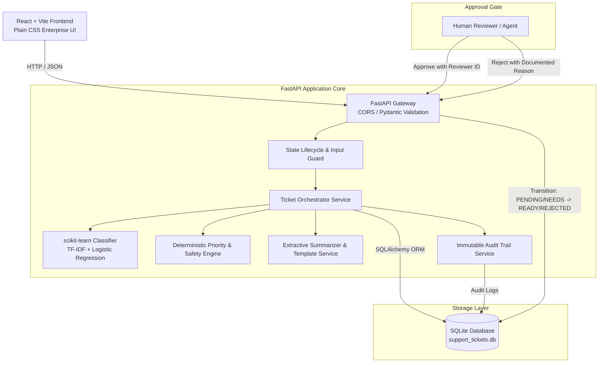
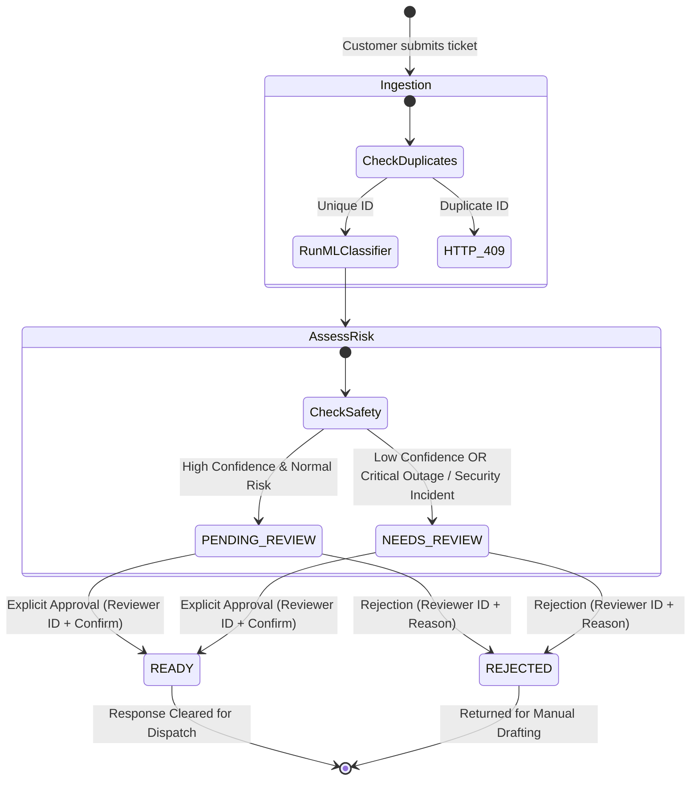

# System Architecture — Support Ticket Automation
## AI-Assisted Support Ticket Processing Platform

### 1. Architectural Overview

The Support Ticket Automation system is designed as a decoupled, multi-tiered enterprise architecture built entirely with zero-cost open-source technologies for local development, while remaining cloud-ready for Microsoft Azure deployment.

The system processes incoming support tickets, generates calibrated machine-learning classifications across 4 business categories, applies deterministic priority and safety rules, drafts polite responses, and enforces a mandatory human-in-the-loop review barrier before any response is released.

---

### 2. Component Breakdown

#### A. Frontend Tier (React 18 + Vite)
- **Role:** Single Page Application (SPA) designed with a clean enterprise dashboard layout using vanilla CSS.
- **Key Modules:**
  - `DashboardStats.jsx`: Real-time aggregated ticket metrics and category/priority distributions fetched from `/metrics`.
  - `TicketForm.jsx`: Ticket ingestion with client-side validation, duplicate ID handling (HTTP 409), and 1-click test scenario presets.
  - `TicketList.jsx`: Interactive data table with search, category filtering, priority filtering, and review status tabs.
  - `TicketDetails.jsx`: Comprehensive inspector modal displaying customer text, model confidence, assigned support team, extractive summary, draft response, and live audit history.
  - `ReviewPanel.jsx`: Human approval gate enforcing reviewer identity, explicit confirmation checkbox, and rejection rationale.
  - `api.js`: Centralized REST client with automatic network error catching and HTTP status code interpretation.

#### B. API Gateway & Validation Tier (FastAPI + Pydantic V2)
- **Role:** High-performance asynchronous API server handling routing, input validation, and HTTP serialization.
- **Key Capabilities:**
  - Strict Pydantic schemas validating string length, non-empty whitespace, and valid confirmation types.
  - Custom exception handlers ensuring no Python stack traces or internal environment variables leak to clients.
  - Auto-generated OpenAPI / Swagger documentation at `/docs`.

#### C. Machine Learning Classification Service (`app/classifier.py`)
- **Pipeline:** `TfidfVectorizer(ngram_range=(1,2), sublinear_tf=True)` + `LogisticRegression(C=1.5, class_weight='balanced')`.
- **Categories:** `Billing`, `Technical`, `Access`, `General`.
- **Uncertainty Engine:**
  - In a 4-class balanced distribution (uniform baseline = 0.25), confidence scores `< 0.40` or class prediction margins `< 0.10` automatically trigger `review_recommendation = True`.
  - Empty or whitespace messages are intercepted before model inference and flagged for review.

#### D. Priority & Safety Rules Engine (`app/priority_service.py`)
- **Deterministic Risk Rules:**
  - **CRITICAL:** Widespread service outages and suspected security incidents automatically override ML classification and force priority to `CRITICAL` and status to `NEEDS_REVIEW`.
  - **HIGH:** Business-critical blockers and payment processing obstructions.
  - **MEDIUM:** Standard operational defects and account inquiries.
  - **LOW:** Routine informational and pricing queries.
- **Team Routing:**
  - `Billing` → `Billing Support`
  - `Technical` → `Technical Support`
  - `Access` → `Identity and Access Support`
  - `General` → `Customer Support`

#### E. Response & Summarization Service (`app/response_generator.py`)
- **Extractive Summary:** Clean sentence-level extraction capturing the customer's primary problem statement without hallucinating facts.
- **Compliant Response Drafts:** Tailored templates that acknowledge receipt, specify next troubleshooting steps, and strictly avoid making unverified claims (such as promises of resolution times or unauthorized financial refunds).

#### F. Persistence & Audit Layer (SQLAlchemy ORM + SQLite)
- **Database Schema:**
  - `tickets`: Stores business ticket identifier (unique constraint), message, predictions, assigned team, draft response, timestamps, and current review status.
  - `audit_logs`: Immutable chronological log capturing every status mutation (`CREATED`, `APPROVED`, `REJECTED`), previous status, new status, reviewer identity, timestamp, and reason.

---

### 3. State Lifecycle & Human Approval Gate

1. Newly created tickets can **never** be initialized as `READY`.
2. Tickets flagged with low confidence or critical risk are assigned `NEEDS_REVIEW`.
3. Standard high-confidence tickets are assigned `PENDING_REVIEW`.
4. A draft transitions to `READY` **only** upon explicit approval by a human reviewer.
5. Rejection mandates a documented explanation.
6. Once marked `READY` or `REJECTED`, the state is locked against accidental re-submission.
